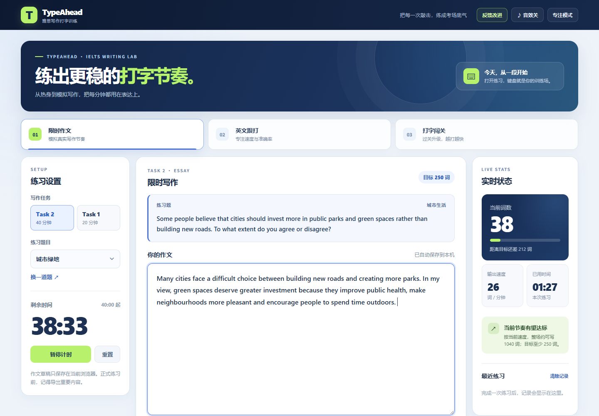

# TypeAhead 雅思写作打字训练

面向准备雅思机考写作的学生。打开网站即可练习，不需要账号。



| 英文跟打 | 打字闯关 |
| --- | --- |
|  |  |

## 当前版本

- 学术写作 Task 1 / Task 2 原创练习题，分别按 20 / 40 分钟计时，显示最低词数目标。
- 5 分钟英文跟打热身，逐字符标记正确和错误，计算准确率及 WPM。
- 三关打字挑战，按完整度、准确率和 WPM 判定通关，逐关解锁并保存本机最佳速度。
- 可开关的轻量键盘音效，使用浏览器 Web Audio 生成，不依赖外部音频文件。
- 实时作文词数、输出速度、剩余时间和按当前速度推算的全程词数。
- 本机草稿自动保存、TXT 导出、专注模式、最近 30 次练习记录。
- 站内「反馈改进」表单，匿名提交的建议保存在站点数据库。
- 按北京时间汇总每日页面浏览和关键功能点击：模式切换、开始及完成练习、反馈打开及提交。仅保存日期、事件名和次数，不收集作文、IP 或浏览器标识。
- 网站不提供 IELTS 分数预测；速度指标仅用于打字训练。

练习题为原创内容，Task 1 表格数据为模拟数据。正式考试信息请以 [IELTS 官方说明](https://ielts.org/take-a-test/test-types/ielts-academic-test/ielts-academic-format-writing)为准。

## 本地预览

```bash
node build.mjs
node server.mjs
```

打开 `http://127.0.0.1:8766`。本地预览使用内存模拟数据库，重启后测试数据会清空。改动数据库结构时，运行 `node node_modules/drizzle-kit/bin.cjs generate` 生成新迁移，再运行 `node build.mjs`。

## 查看反馈和访问数据

在 Sites 的站点设置中打开数据库查看器，选择 `DB` 绑定：

- `daily_metrics`：`day` 是北京时间日期，`event = page_view` 的 `count` 是当天页面浏览次数；其他事件的 `count` 是相应功能点击或完成次数。刷新页面会再次计入浏览量；不计算独立访客。
- `feedback`：按 `created_at` 查看反馈类型和内容。

首批用户无需注册即可免费使用。统计接口只接受固定事件名，反馈接口限制内容长度并使用隐藏字段过滤普通机器人提交。上线后应定期检查反馈和异常流量。

## 上线与收费路线

这一版适合先开放免费测试打字训练的真实需求。练习记录目前仅存在用户自己的浏览器里，换设备不会同步；也没有账号、支付或付费权益。

首批用户在中国大陆，项目方已有微信／支付宝商户账户。建议先观察页面浏览、练习启动与完成、闯关兴趣和反馈，再决定首个付费权益与价格。若数据支持收费，可增加账号与跨设备进度、按薄弱项生成训练计划和更完整的考试模拟。支付接入还需要商户号与安全密钥等配置，不能写入前端代码。
